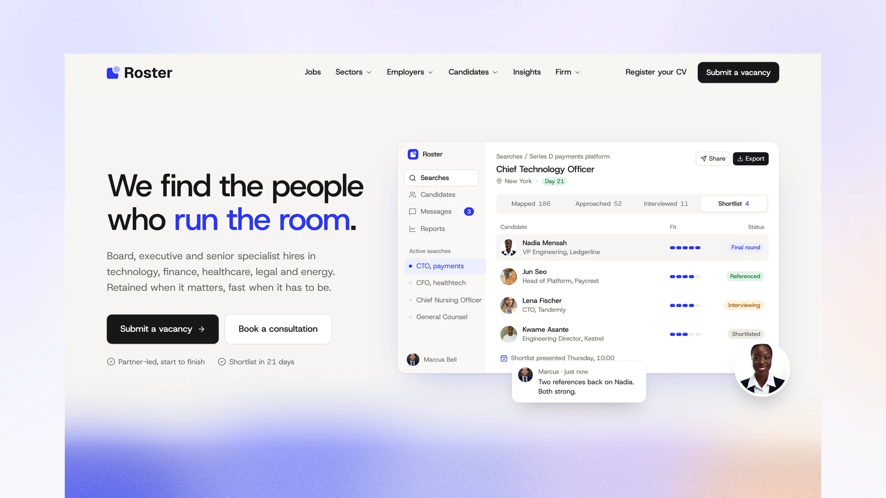

# Roster - Astro Recruitment Theme

[](https://roster.xocoweb.workers.dev/)

[](https://astro.build/)
[](https://tailwindcss.com/)
[](https://www.typescriptlang.org/)
[](./LICENSE)

**Live preview:** https://roster.xocoweb.workers.dev/

Roster is a premium Astro theme for recruitment agencies and executive search firms. Soft white cards, an ultramarine accent and product-style panels give it the polish of a hiring platform, while the jobs board, salary guide and case studies keep it a search firm. Jobs, sectors, consultants and case studies are content collections, the copy lives in config files, and the output is fully static.

## Features

- A jobs board with keyword search, faceted filters with live counts, sorting, and filters kept in the URL
- Job pages with key facts, the consultant running the search, an apply form with CV upload, and Google for Jobs structured data
- A multi-step "Submit a vacancy" flow with validation and a review screen before sending
- Candidate registration with CV upload, sectors, work preferences and notice period
- Forms that run in demo mode until you add an endpoint, so every flow works in the preview
- A salary guide with sector tables per city and a salary calculator that places your pay against the market
- A downloadable salary report lead magnet on the salary guide
- Sector pages that gather their live roles, salary bands, case studies and consultants
- Consultant profiles with direct lines, a booking link, their live roles, placements and articles
- Placement case studies with headline metrics and a client quote
- A consultation booking panel that embeds Cal.com or Calendly, or offers its own slot picker
- A homepage with product-style panels of a search, a shortlist, a candidate's matches and a salary check, built from your content
- Full-width mega menus fed by your content: sectors with live role counts, newest roles, a featured placement, the team
- A field of candidate portraits that pop in and out across a dot grid
- Insights with topics, a lead article, a table of contents, a reading-progress bar, a share sheet and search (`/` or `⌘K`)
- Photography from Pexels, credited per image
- Canonical URLs, sitemap, RSS, `robots.txt`, Open Graph, Twitter/X cards, and JSON-LD for the agency, jobs and articles
- Self-hosted Host Grotesk, Lucide icons, and colour and type tokens in one stylesheet
- Static output with no framework islands; every animation settles under `prefers-reduced-motion`
- Skip link, landmarks, labelled controls, visible focus states, and keyboard support for every menu, filter, form and dialog

## Tech Stack

- Astro 7 with MDX
- Tailwind CSS 4 via the Vite plugin
- Vite 8, TypeScript, Astro content collections
- `@astrojs/sitemap`, `@astrojs/rss`, Sharp
- Self-hosted Host Grotesk, Lucide and Bootstrap Icons, each with its license notice

## Requirements

- Node.js `22.12.0` or newer
- npm

## Getting Started

```bash
npm install
npm run dev
```

Build for production:

```bash
npm run build
```

Preview the production build locally:

```bash
npm run preview
```

Before shipping a change, run type checking, the production build, and the formatter check together:

```bash
npm run release:check
```

## Customization

See [CUSTOMIZATION.md](./CUSTOMIZATION.md) for site settings, offices, navigation, forms, booking, jobs, sectors, consultants, placements, the salary guide, the homepage and inner pages, insights, and the theme's design tokens.

Set `siteConfig.siteUrl` in [src/config/site.ts](./src/config/site.ts) before building — canonical URLs, share images, the sitemap, the feed and the job structured data are all derived from it. The build is static, so any host that serves a directory works: `wrangler.jsonc` is included for Cloudflare Workers, and Netlify, Vercel, GitHub Pages, and object storage behind a CDN need no configuration beyond `npm run build`.

## Content

Content lives in [src/content](./src/content), validated by the schemas in [src/content.config.ts](./src/content.config.ts):

- `jobs`: one Markdown file per role
- `sectors`: one file per practice, with its image in [src/assets/sectors](./src/assets/sectors)
- `team`: one folder per consultant, with an `index.md` and a `photo.jpg`
- `placements`: one file per case study
- `insights`: one folder per article, with an `index.md` and a `cover.jpg`

The bundled demo content is fictional — the firm, the consultants, the clients, the roles, the quotes and the salary figures are invented, so **replace them before launch.** The consultant portraits and the candidate portraits in [src/assets/people](./src/assets/people) are stock photos of people with no connection to the names beside them, and the client logos are fictional marks. The privacy notice is sample text.

Demo photography comes from [Pexels](https://www.pexels.com/) under its license, credited in the frontmatter of each sector, consultant and article, and in [src/config/about.ts](./src/config/about.ts) and [src/config/showcase.ts](./src/config/showcase.ts).

## Support

See [SUPPORT.md](./SUPPORT.md) for what a license includes, and [CHANGELOG.md](./CHANGELOG.md) for release history.

## License

Commercial license. See [LICENSE](./LICENSE) for complete terms.

## Credits

- [Host Grotesk](https://github.com/Element-Type/HostGrotesk) by Element Type, under the SIL Open Font License
- The fictional client logos are set in Fraunces, Space Grotesk, Syne, Archivo Black, Outfit, DM Serif Display, Sora, Unbounded, Manrope, and IBM Plex Mono, all under the SIL Open Font License, converted to outlines
- [Lucide](https://lucide.dev/), under the ISC License
- [Bootstrap Icons](https://icons.getbootstrap.com/), under the MIT License
- Photography from Pexels, credited per image
